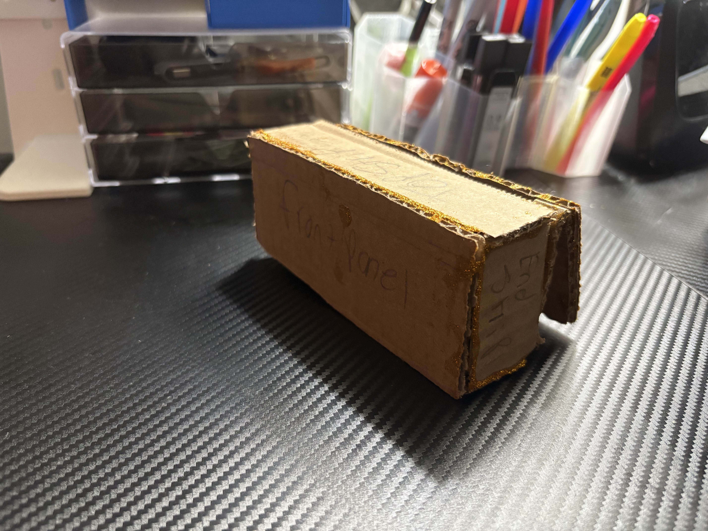

# Dirt Bike Speedometer
A rechargeable, handlebar-mounted speedometer for dirt bikes. A wheel magnet and Hall sensor feed an ESP32-C3, which shows speed on a big LED display that's easy to read at a glance.

Status: In planning. I'm building a cardboard mockup of the case to test size and fit. CAD, wiring, and firmware come next.

 
Why I'm building this

My dirt bike has no battery, so a normal speedometer won't work. I wanted a unit that carries its own battery, mounts to the handlebars, and comes off easily to charge. It shows speed and nothing else, in big digits, so I can keep my eyes on the trail instead of squinting at a screen.

Features
Speed only, shown in MPH or km/h in large red digits
Rechargeable internal battery, charged over USB-C with the unit removed from the bike
Handlebar mount with a sun hood and tinted window to cut glare
Planned: Bluetooth link to a phone for speed and RPM and ride logging
How it works
A small magnet on the front wheel passes a Hall effect sensor on the fork once per wheel revolution.
A Seeed XIAO ESP32-C3 times the pulses and converts them to speed using the tire's rolling circumference.
Speed shows on a 1.2" 4-digit red 7-segment LED display, chosen because LEDs stay readable in direct sunlight.
A 1200 mAh LiPo battery powers everything. The XIAO charges it over USB-C.
Parts (BOM)

Full list: BOM.csv

Part	Qty	Price	Link	Notes
Seeed XIAO ESP32-C3	1	$4.99	Seeed	Wi-Fi and Bluetooth LE board with battery charging
Adafruit 7-segment display driver	1	$6.95	Adafruit	I2C driver board for the display
Adafruit red 4-digit display (1.2")	1	$7.50	Adafruit	Shows the speed
3.7 V 1200 mAh protected LiPo battery	1	$9.95	Adafruit	Rechargeable battery
Hall effect sensor module	1	about $5	Amazon search	Must work at 3.3 V with a safe 3.3 V output. Exact part to be confirmed.
Small neodymium disc magnet	1	about $2-4	Amazon search	Attaches to the wheel
Heat-shrink pack	1	$4.95	Adafruit	Insulates solder joints
Jumper wires	1	$1.95	Adafruit	Prototyping wire
JST-PH 2-pin cable	1	about $1	Adafruit	Optional lead for the XIAO battery pads
Printed enclosure (nylon)	1	TBD	TBD	Needs the CAD file for a quote. Print service to be decided.

Estimated parts cost: about $44 before the case, tax, and shipping. This will change as the BOM is finalized.

Case design
Two-piece enclosure, about 5-3/8 × 2-3/8 × 1-3/8 inches (roughly 135 × 60 × 35 mm)
Window sized for the 1.2" display, with a sun hood above it and a tinted window to cut glare
Openings for the USB-C port, a power switch, and a sealed connector for the sensor cable
Back plate that opens so the battery is reachable
Flat back that bolts to a handlebar clamp
I'm prototyping in cardboard first to test the size, sightline, and clearance around the bars. The final case will be 3D printed in a durable nylon.
<!-- Uncomment these after you upload photos and renders:   -->

CAD files will go in CAD/.

Wiring
From	To
Hall sensor power and ground	XIAO 3V3 and GND
Hall sensor output	One XIAO GPIO input (pin to be decided)
Display driver power and I2C	XIAO power and I2C pins (to be decided)
LiPo battery	XIAO battery pads, through a JST-PH lead

I'll fill in the exact pins after bench testing.

<!-- Add a wiring diagram:  -->
Firmware (planned approach)
An interrupt fires on each Hall sensor pulse (one per wheel revolution).
The time between pulses gives wheel RPM and speed (rolling circumference divided by the pulse period).
The display shows zero when pulses stop.
I'll measure the tire's rolling circumference with my weight on the bike and enter it as a setting.
Later: send speed and RPM to a phone over Bluetooth LE for ride logging.

Code will go in Firmware/.

Safety
Keep the magnet, sensor, wiring, and case clear of the tire, spokes, brake, and suspension.
Test at low speed in a safe area first, and compare against a trusted speed reference before relying on the readout.
Roadmap
 Write the project plan and parts list
 Confirm the Hall sensor works at 3.3 V and finalize the BOM
 Finish the cardboard mockup and test size, sightline, and bar clearance
 Model the case in CAD and get it printed
 Wire the display and sensor and bench test (spin the wheel by hand and compare RPM to a manual count)
 Mount on the bike, measure the tire circumference, and calibrate
 Test at low speed in a safe area and check daylight readability
 Add Bluetooth to a phone for ride logging
Repo layout
CAD/ case design files
Firmware/ code
images/ photos and diagrams
BOM.csv parts list
journal.md build log
License

MIT. See LICENSE.
